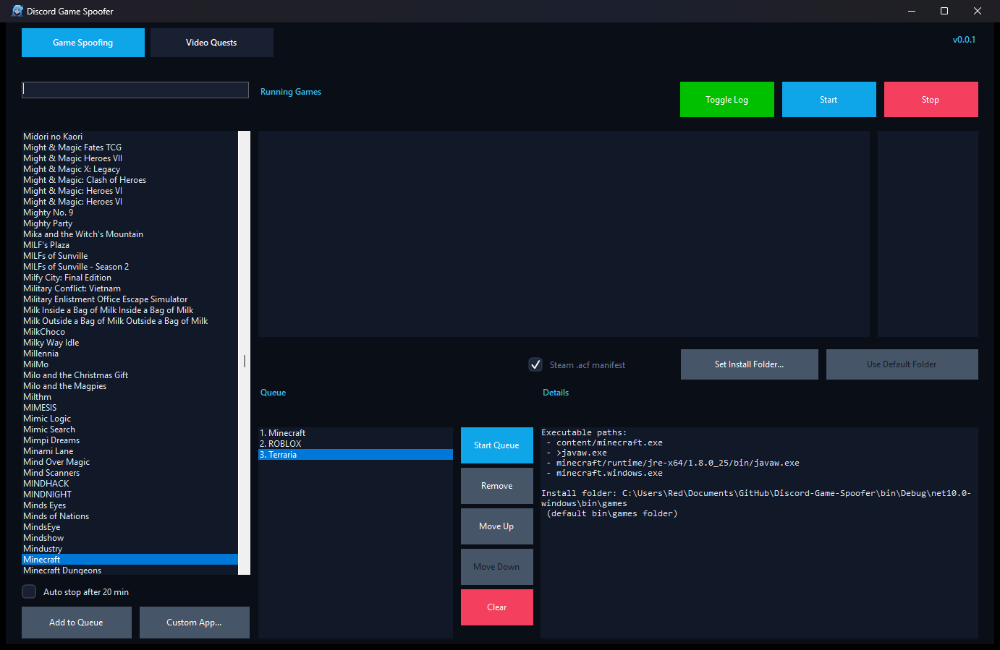
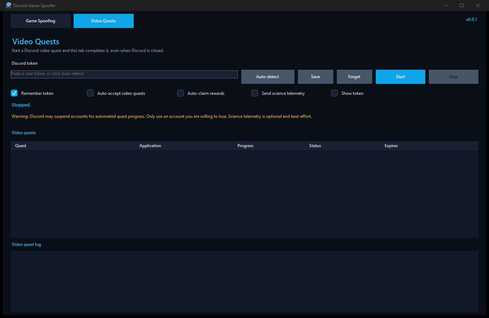

# Discord Game Spoofer

A Windows utility for spoofing Discord-detectable games and completing Discord Quests without installing or launching the real game.

This is the **[Redesu](https://github.com/Redesu) fork** of [devAxri/Discord-Game-Spoofer](https://github.com/devAxri/Discord-Game-Spoofer). It keeps the original game spoofer and adds queueing, Steam manifest support, and a full video-quest automation tab.

## Screenshots

## What's new in this fork

* **Game queue** - queue several games and run them back to back, with automatic 20-minute rotation.
* **Steam `.acf` manifests** - create a matching Steam manifest and place the spoof executable inside the Steam library, so quests that verify a Steam install can detect the game.
* **Video Quests tab** - watch and advance Discord video quests without keeping Discord open.
* **Auto-accept and auto-claim** - enroll in new video quests automatically and claim rewards once Discord marks them complete.
* **Token auto-detection** - read the Discord token from Discord's local storage, or paste one manually.
* **Encrypted token storage** - saved tokens are protected with Windows DPAPI for the current user.
* **Custom applications** - add games that are missing from Discord's list.
* **Per-game install folders** - save each spoof executable into that game's real install folder.
* **Visible spoof hosts** - spoofed processes show a small window so Discord detects them reliably.
* **Random executable sizes** - every generated spoof executable has a different size.
* **Fits any screen** - the window opens centered at a size that fits the current display, and the layout reflows when resized or maximized.
* **Automated releases** - GitHub Actions builds a self-contained Windows executable and attaches a SHA-256 checksum.

## Features

* Spoof Discord Quests by simulating supported games
* Search through Discord-detectable games
* Start and stop spoofed game processes
* Track how long each spoofed game has been running
* Queue multiple games and run them one after another
* Reorder, remove, or clear queued games
* Optional auto-stop after 20 minutes (queued games always auto-stop)
* Add custom applications that are not in the Discord list
* Place a game's spoof executable in its real install folder per game
* Optional Steam `.acf` manifest so quests that verify Steam installs can detect the game
* Every generated spoof exe gets a different random file size
* Complete Discord **video quests** without keeping Discord open
* Auto-detect the Discord token from Discord's local storage, or paste one manually
* Optional auto-accept and auto-claim for video quests
* Encrypted token storage with Windows DPAPI
* View executable details for selected games
* Built-in update check
* Responsive Windows Forms interface that works on small and large displays

## Download

Grab the latest build from the [Releases](https://github.com/Redesu/Discord-Game-Spoofer/releases) page. Releases are self-contained Windows x64 builds, so .NET does not need to be installed separately.

The original project is available at [devAxri/Discord-Game-Spoofer](https://github.com/devAxri/Discord-Game-Spoofer).

## Usage

### Single game

1. Open Discord Game Spoofer.
2. Wait for the detectable games list to load.
3. Search for the game required by the Discord Quest.
4. Select the game.
5. Click **Start**.
6. A small **Now spoofing** window opens. Keep it visible; Discord ignores hidden processes and processes without a window.
7. Keep it running until the quest requirement is completed.
8. Click **Stop** when you are done.

Check **Auto stop after 20 min** if you want the game to close automatically. Queue games always stop after 20 minutes so the next game can start.

### Install folder

Some quests check that the game is running from its install folder. To change where the spoof executable is created:

1. Select the game.
2. Click **Set Install Folder...** and choose a folder, for example the game's real install folder.
3. Click **Use Default Folder** to go back to `bin\games`.

The executable is created at `<install folder>\<executable path>`. For example, if Discord lists `aces.exe`, it is created as `<install folder>\aces.exe`. Existing files that were not created by this app are never overwritten. Install folders are saved per game in `bin/game_folders.json`.

Windows may deny writes to protected folders such as `C:\Program Files`. In that case, choose a folder you can write to or run the app as administrator.

### Steam manifests

Some Discord Quests now check that the game is installed through Steam, not just that an executable is running. Discord Game Spoofer can create a matching Steam manifest for games that have a Steam app ID in Discord's game list.

**Steam .acf manifest** is enabled by default when Steam is detected and the selected game has a Steam app ID. When it is on:

1. The spoof executable is created in `<Steam library>\steamapps\common\<installdir>\<executable path>`.
2. An `appmanifest_<appid>.acf` file is created in `<Steam library>\steamapps`.
3. The official `installdir` is read from the SteamCMD API when possible, so the folder name matches a real install.

The checkbox is disabled for games that do not have a Steam app ID. If you set a custom install folder, Steam mode still takes precedence while the checkbox is ticked; untick it to use the custom folder instead.

The app never overwrites an existing `appmanifest_*.acf` file. Manifests created by the app are recorded in `bin/steam_manifests.json` and removed when the app closes, but only if they are still unchanged. Real Steam installs are left alone. Steam may need to be restarted before its own library view notices a new manifest; Discord reads the files directly.

### Queue

1. Select a game and click **Add to Queue**.
2. Repeat for every game you want to run.
3. Use **Move Up**, **Move Down**, **Remove**, or **Clear** to manage the queue.
4. Click **Start Queue**.

Each queued game runs for 20 minutes, then closes and starts the next one. Clicking **Stop** while a queued game is running pauses the queue; click **Start Queue** to continue with the remaining games. **Clear** removes the waiting games but lets the current game finish normally.

### Video quests

The **Video Quests** tab completes quests that require watching a video. Discord does not need to stay open while the progress is sent.

1. Open the **Video Quests** tab.
2. Get a token:
   * Click **Auto-detect** to read the token from Discord's encrypted local storage, or
   * Paste a Discord user token into the box yourself.
   * If the box is empty when you click **Start**, the app runs Auto-detect automatically.
3. Leave **Remember token** ticked if you want the token saved for next time.
4. Click **Start**.
5. Start a video quest in Discord, then close Discord if you want. If **Auto-accept video quests** is ticked, the app enrolls in new video quests for you.
6. Keep Discord Game Spoofer open until the progress reaches the target.

The tab polls `GET /api/v9/quests/@me` every 20 seconds. For an enrolled video quest it sends `POST /api/v9/quests/{id}/video-progress` every 7 to 9.5 seconds with whole-second `{"timestamp": seconds}` values that advance from the last progress Discord reported (seeded from `user_status.progress`, never from `enrolled_at`). This matches Discord's desktop client, which reports incremental video time and skips the call unless `user_status.enrolled_at` is set and the quest is not completed or expired. Only one video quest is advanced at a time.

If Discord answers `400`, `403`, `404`, `409` or `410` for video progress, the quest is skipped for 10 minutes instead of being retried in a loop, and the response body is written to the log. A `404` usually means the quest is not enrolled for your account or has expired. Discord includes a `user_status` object with an empty `progress` map even for quests you have not accepted yet, so the app treats a quest as enrolled only when `enrolled_at` (or a later stage timestamp) is present. Enable **Auto-accept video quests** to enroll in a quest before watching it. Quest expiry is read from `config.expires_at`; expired quests are ignored.

**Auto-claim rewards** claims the reward with `POST /api/v9/quests/{id}/claim-reward` after Discord marks the quest complete. If Discord has not confirmed completion yet, the claim is retried on a later poll.

**Tokens:** Auto-detect reads Discord's `Local State` key with Windows DPAPI, decrypts the AES-256-GCM token entries in `Local Storage\leveldb`, and checks each candidate against `GET /api/v9/users/@me`. The token is never written to the log. If **Remember token** is on, it is stored in `bin/discord_token.dat`, encrypted with DPAPI for the current Windows user. A Discord token gives full access to the account, so never share it, paste it into an untrusted program, or include it in screenshots and issue reports. Click **Forget** to delete the saved copy.

**Science telemetry:** Discord's own client also posts video progress to `/api/v9/science`. That request uses a separate short analytics token which Discord does not store locally, so **Send science telemetry** is optional and best-effort: it uses the account token instead. The `/video-progress` request is the one that actually advances the quest, so this option can stay off.

> **Warning:** Automating quests may violate Discord's Terms of Service. Quest automation has been linked to account suspensions since April 2026. Only use an account you are willing to lose.

### Custom application

If a game is not in the list:

1. Click **Custom App...**.
2. Enter a name for the app.
3. Enter the executable name, for example `game.exe`.
4. Enter the folder to create it in under `bin\games`, for example `Game\bin`.
5. Click **Add**.

The custom app appears in the games list and can be started or queued like any other game. Custom apps are saved in `bin/custom_apps.json`.

### Window size

The main window opens centered and sized for the screen it is on. It can be resized or maximized, and every list, text box, and button reflows to the available space. On smaller displays the window shrinks down to a usable minimum instead of opening off-screen.

## Notes

This project is not affiliated with Discord or with the original author. Use it responsibly and at your own risk.

## Contributing

Pull requests are always welcome. Feel free to open an issue for bugs, suggestions, or improvements.
